<div align="center">

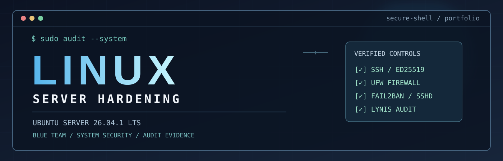

# Linux Server Hardening &amp; Security Auditing Lab

**Deploy. Assess. Harden. Validate. Document.**

A hands-on defensive cybersecurity project using Ubuntu Server, least-privilege access control, SSH, UFW, Fail2ban, automatic security updates, Linux logging, and Lynis auditing.


</div>

---

## Project overview

This project demonstrates a practical **blue-team system-hardening workflow** on a dedicated Ubuntu Server virtual machine. I established an audit baseline, implemented security controls, verified them with Linux commands and remote-access tests, and repeated the Lynis assessment to measure change.

The work was performed in an isolated **VirtualBox lab**, administered primarily from **Windows PowerShell over SSH**. Each significant control is supported by a screenshot in the [evidence gallery](#security-evidence--screenshots).

> **Project outcome:** Lynis Hardening Index improved from **60 to 64** (+4 points). The final audit detected both firewall and intrusion-prevention software where neither was detected in the initial audit. A Lynis score is **not** a percentage measure of security or proof that all vulnerabilities are resolved.

## Security evidence / screenshots

**All 12 screenshots are displayed below, directly in this README.** The images document configuration and testing rather than installation screens alone.

<table>
<tr>
<td width="50%" align="center">
<strong>01 · Ubuntu Server baseline</strong><br/>
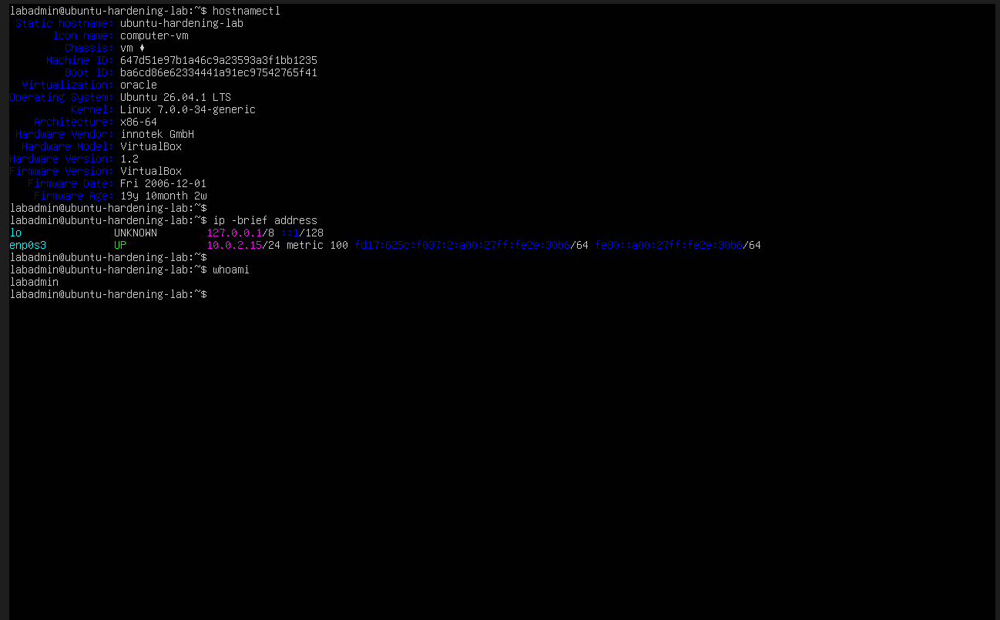
<br/><sub>System identity and network verified</sub>
</td>
<td width="50%" align="center">
<strong>02 · System patching</strong><br/>
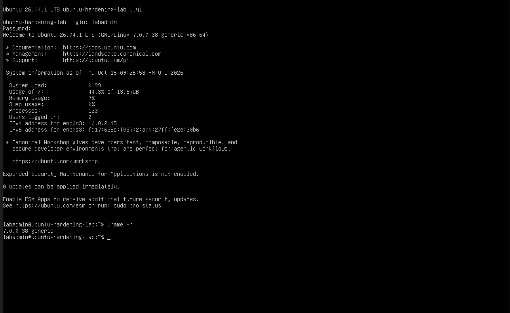
<br/><sub>Updated Linux kernel verified</sub>
</td>
</tr>
<tr>
<td width="50%" align="center">
<strong>03 · Least-privilege accounts</strong><br/>
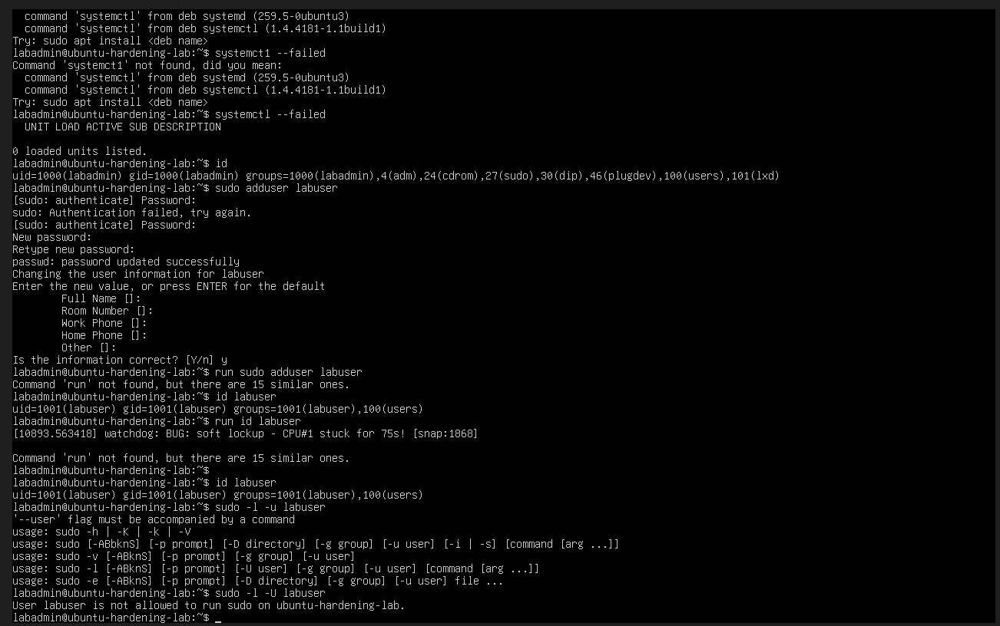
<br/><sub>Admin and standard-user access compared</sub>
</td>
<td width="50%" align="center">
<strong>04 · Directory permissions</strong><br/>
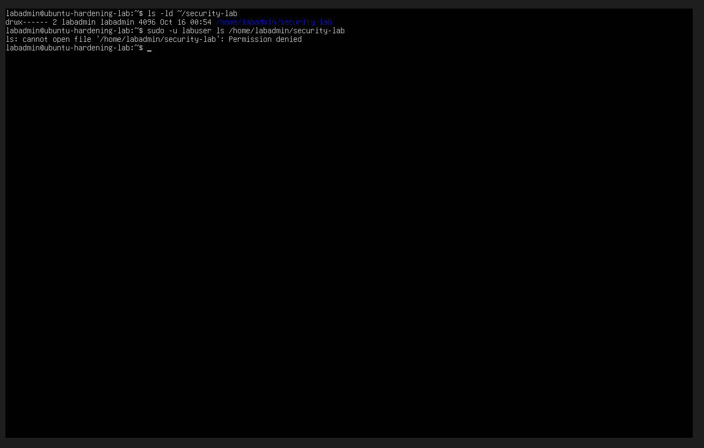
<br/><sub>chmod 700 and denied access</sub>
</td>
</tr>
<tr>
<td width="50%" align="center">
<strong>05 · File ownership</strong><br/>
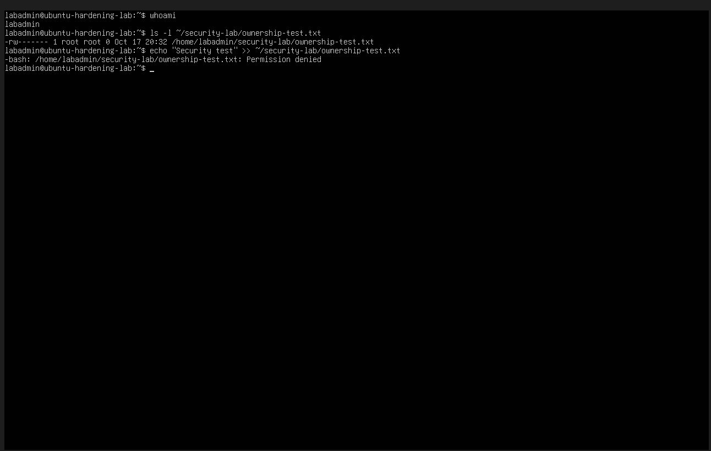
<br/><sub>Root-owned file protected from writes</sub>
</td>
<td width="50%" align="center">
<strong>06 · SSH remote access</strong><br/>
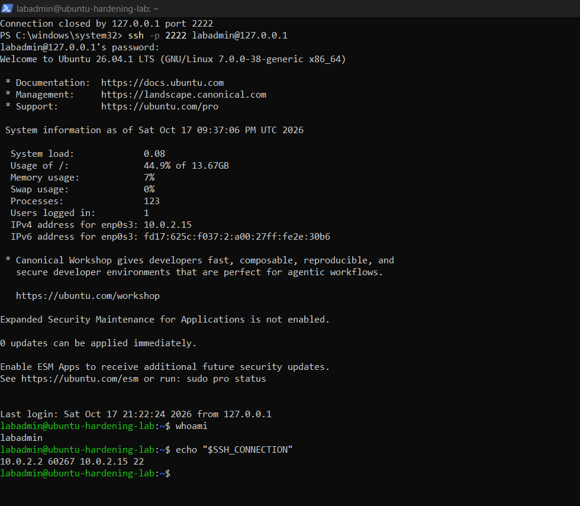
<br/><sub>Windows PowerShell connection to Ubuntu</sub>
</td>
</tr>
<tr>
<td width="50%" align="center">
<strong>07 · Lynis baseline</strong><br/>
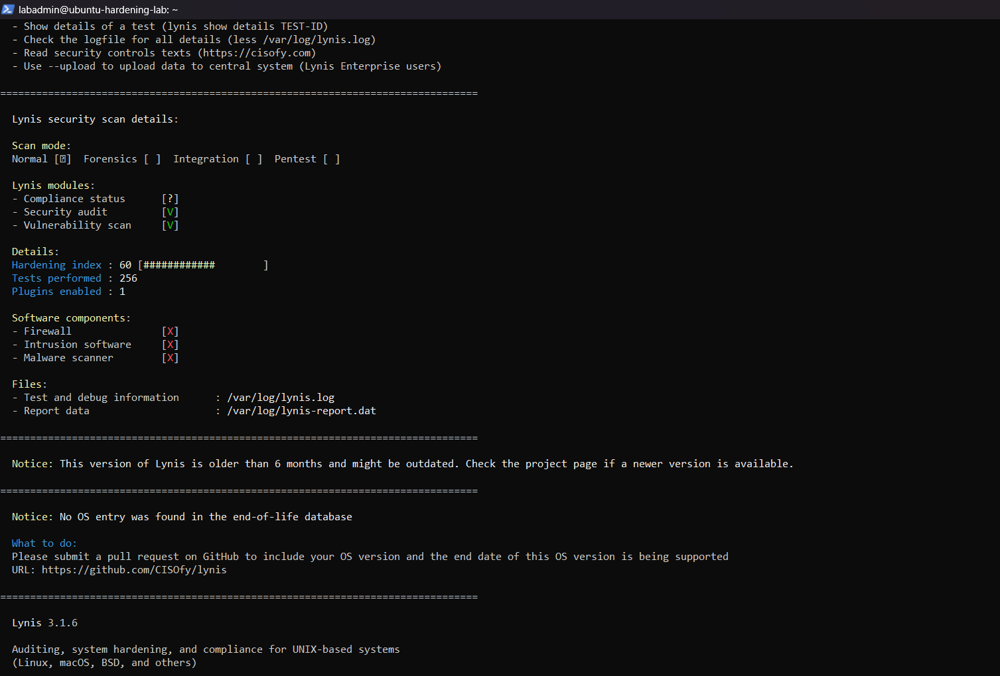
<br/><sub>Initial Hardening Index: 60</sub>
</td>
<td width="50%" align="center">
<strong>08 · UFW firewall</strong><br/>
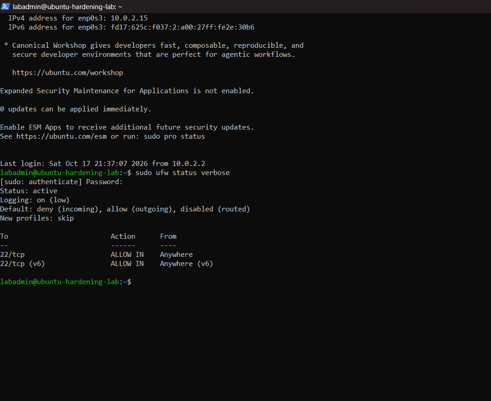
<br/><sub>Default-deny inbound firewall</sub>
</td>
</tr>
<tr>
<td width="50%" align="center">
<strong>09 · SSH key authentication</strong><br/>
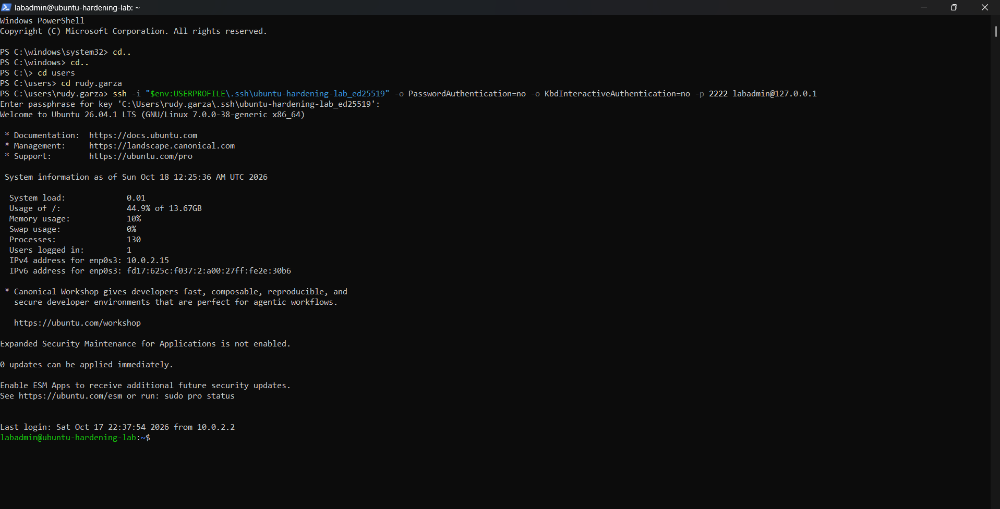
<br/><sub>ED25519 authentication verified</sub>
</td>
<td width="50%" align="center">
<strong>10 · SSH server hardening</strong><br/>
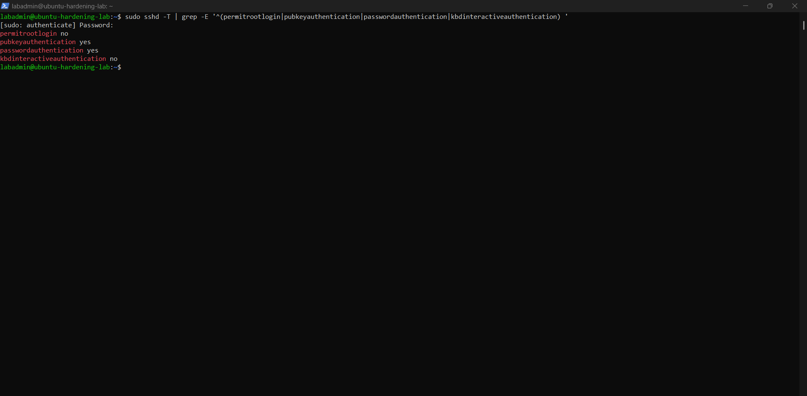
<br/><sub>Direct root SSH login disabled</sub>
</td>
</tr>
<tr>
<td width="50%" align="center">
<strong>11 · Fail2ban monitoring</strong><br/>
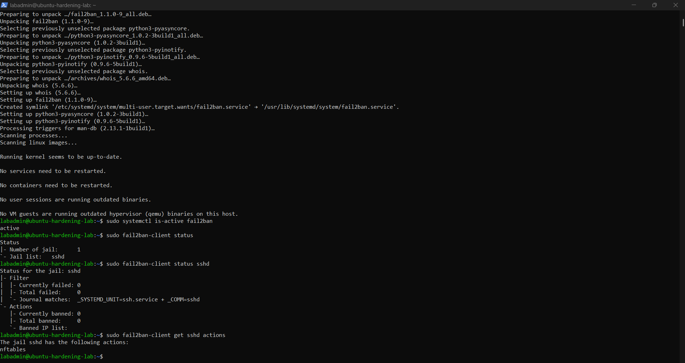
<br/><sub>SSH jail and nftables action</sub>
</td>
<td width="50%" align="center">
<strong>12 · Lynis comparison</strong><br/>
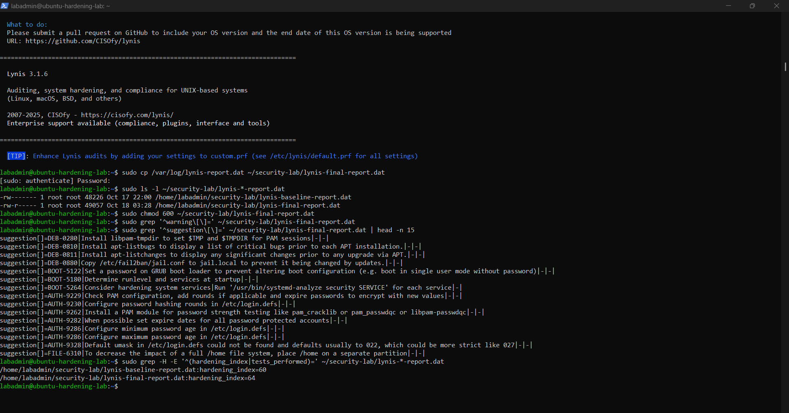
<br/><sub>Final Hardening Index: 64</sub>
</td>
</tr>
</table>

> **Evidence note:** Each image is from the lab environment. No private SSH keys, passwords, or raw audit reports are included.

## Lab environment

| Component | Implementation |
|---|---|
| Operating system | Ubuntu Server **26.04.1 LTS** (64-bit) |
| Virtualization | Oracle VirtualBox on a Windows host |
| VM allocation | 2 vCPUs, 4 GB RAM, 30 GB virtual disk |
| Networking | VirtualBox NAT; host `127.0.0.1:2222` forwarded to guest TCP `22` |
| Administration | Windows PowerShell and OpenSSH |
| Administrative account | `labadmin` with sudo access |
| Standard account | `labuser` without sudo permissions |
| Auditing | Lynis 3.1.6 (Ubuntu-packaged version used during the lab) |
| Firewall / intrusion prevention | UFW / Fail2ban with `sshd` jail and nftables action |

### Network and authentication design

```text
 Windows host (PowerShell)
        |
        | SSH public-key authentication (ED25519)
        | 127.0.0.1:2222
        v
  VirtualBox NAT port forwarding
        |
        | Guest TCP/22
        v
  +--------------------------------------+
  | Ubuntu Server 26.04.1 LTS            |
  |                                      |
  | UFW: deny incoming by default       |
  |      allow SSH on TCP/22             |
  |                                      |
  | SSH: direct root login disabled     |
  |      public-key authentication yes   |
  |                                      |
  | Fail2ban: sshd jail + nftables      |
  | Lynis: baseline and final audits    |
  +--------------------------------------+
```

## Security controls implemented and verified

| Area | Configuration / validation | Evidence |
|---|---|---|
| System baseline | Verified hostname, Linux version, network interface, and logged-in account | [01](screenshots/01-ubuntu-server-baseline.png) |
| Patch management | Applied system updates and verified updated kernel `7.0.0-38-generic` | [02](screenshots/02-system-updated-new-kernel.png) |
| Least privilege | Created separate administrator and standard accounts; verified `labuser` has no sudo authorization | [03](screenshots/03-linux-least-privilege-access-control.png) |
| Directory permissions | Configured `chmod 700`; verified the standard account was denied access | [04](screenshots/04-linux-file-permissions-security.png) |
| File ownership | Used `chown` and `chmod 600`; verified a non-root user could not write to a root-owned test file | [05](screenshots/05-linux-file-ownership-security.png) |
| Remote administration | Established authenticated SSH connectivity from Windows through VirtualBox NAT | [06](screenshots/06-ssh-remote-administration.png) |
| Initial assessment | Completed a Lynis baseline before the later firewall and intrusion-prevention work | [07](screenshots/07-lynis-initial-security-audit.png) |
| Host firewall | Enabled UFW with `deny incoming`, `allow outgoing`, and a TCP/22 allow rule; retested SSH | [08](screenshots/08-ufw-firewall-security.png) |
| SSH key authentication | Created a passphrase-protected ED25519 key and verified login without password fallback for the test connection | [09](screenshots/09-ssh-key-authentication.png) |
| SSH server hardening | Set `PermitRootLogin no`, validated configuration, and confirmed key-based access remained available | [10](screenshots/10-ssh-server-hardening.png) |
| Authentication monitoring | Confirmed active Fail2ban `sshd` jail reading journal events with nftables blocking action configured | [11](screenshots/11-fail2ban-ssh-protection.png) |
| Final assessment | Re-ran Lynis and compared the two saved audit reports | [12](screenshots/12-lynis-security-audit-comparison.png) |

### Additional checks

- **Automatic updates:** Verified `unattended-upgrades` installed, daily periodic settings configured, upgrade timer enabled, and Ubuntu security repository included.
- **Security logging:** Inspected SSH journal entries for password and public-key logins, and confirmed logs existed across seven recorded boots.
- **Service health:** Confirmed `systemctl --failed` reported zero failed units during a health check.
- **Audit preservation:** Stored the baseline and final Lynis reports separately with restrictive file permissions (`600`). The raw reports are **not published** because they may contain system-specific security information.

## Before-and-after security assessment

| Lynis measure | Initial audit | Final audit |
|---|---:|---:|
| **Hardening Index** | **60** | **64** |
| Tests performed | 256 | 258 |
| Firewall detected | No | Yes |
| Intrusion-prevention software detected | No | Yes |
| Malware scanner detected | No | No |

**Hardening Index change: +4 points.** The number of Lynis tests also changed, so the two scores are useful indicators, not a controlled security-effectiveness experiment.


<details>
<summary><strong>Audit verification commands</strong></summary>

```bash
sudo lynis audit system --quick
sudo grep -H '^hardening_index=' ~/security-lab/lynis-*-report.dat
```

The first command performs the audit. The second reads the score from each preserved report. Audit files were stored inside the server's protected lab directory and were not committed to this repository.

</details>

## Selected verification commands

These commands were used to **inspect the lab**, not as a ready-to-run production hardening script.

```bash
# Confirm the current user and permissions
id labadmin
id labuser
sudo -l -U labuser

# Validate the effective SSH server settings
sudo sshd -t
sudo sshd -T | grep -E '^(permitrootlogin|pubkeyauthentication|passwordauthentication|kbdinteractiveauthentication) '

# Check firewall rules and SSH monitoring
sudo ufw status verbose
sudo fail2ban-client status sshd
sudo fail2ban-client get sshd actions

# Verify automatic patching and authentication logs
systemctl is-enabled apt-daily-upgrade.timer
sudo journalctl -u ssh.service -n 15 --no-pager
sudo journalctl --list-boots
```

## Remaining risks and project limitations

A credible security project documents what **has not** been resolved:

1. **SSH password authentication remains enabled on the server.** ED25519 key login works, but password login was not disabled server-wide because the VM stability issue remains unresolved. The test with `PasswordAuthentication=no` affected only the SSH client used for that connection.
2. **VirtualBox CPU soft-lockup warnings occurred repeatedly.** The Windows host uses the Microsoft hypervisor/VBS, and the VirtualBox VM displayed its compatibility indicator. The root cause was not conclusively established or resolved.
3. **Fail2ban's blocking action was configured, not attack-tested.** The `sshd` jail was active and used nftables, but no deliberate failed-login ban test was performed to avoid disrupting lab administration.
4. **Lynis identified further hardening suggestions**, including password policies, PAM settings, service review, and filesystem recommendations. They were reviewed but not all implemented.
5. **Malware scanner was not detected** in either Lynis audit. A scanner is not automatically required for every minimal Linux server; any decision to add one should depend on the threat model.
6. **Lynis reported an outdated version / missing OS end-of-life entry** in its database. Findings should be interpreted in light of the installed version and support for the current OS release.

### Recommended follow-up hardening

- Resolve VM reliability and retain a tested local-console recovery method.
- Back up SSH configuration, verify multiple new key-based sessions, then evaluate disabling SSH password authentication on the server.
- Review Lynis recommendations by risk and document any additional remediation with another audit.
- Document or test Fail2ban enforcement safely using a separate test source, without risking the administrative connection.

## Skills demonstrated

`Linux Administration` · `System Hardening` · `Least Privilege` · `IAM` · `SSH / ED25519` · `UFW` · `Fail2ban` · `nftables` · `Patch Management` · `journald` · `Lynis` · `Security Assessment` · `Technical Documentation`

## Resume-ready project bullet

> Built and hardened an Ubuntu Server 26.04 LTS virtual machine by configuring least-privilege user access, restrictive file permissions, ED25519 SSH authentication, UFW firewall rules, Fail2ban SSH monitoring, automatic security updates, and logging. Conducted before-and-after Lynis assessments and improved the Hardening Index from 60 to 64, documenting verified controls and remaining risks.

## Scope and responsible disclosure

This is a **personal defensive-security training lab**, not a production environment. No internet-facing SSH service or adversarial testing is implied. Credentials, private SSH keys, and raw system-audit artifacts are intentionally excluded from this public repository.

---

<div align="center">

**ASSESS → HARDEN → VERIFY → DOCUMENT**

*Ubuntu Linux Server Hardening | Cybersecurity Portfolio Project*

</div>
